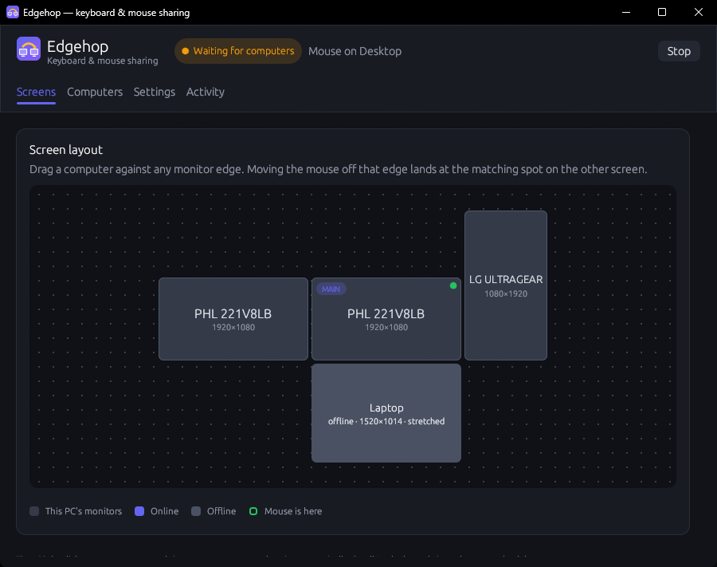
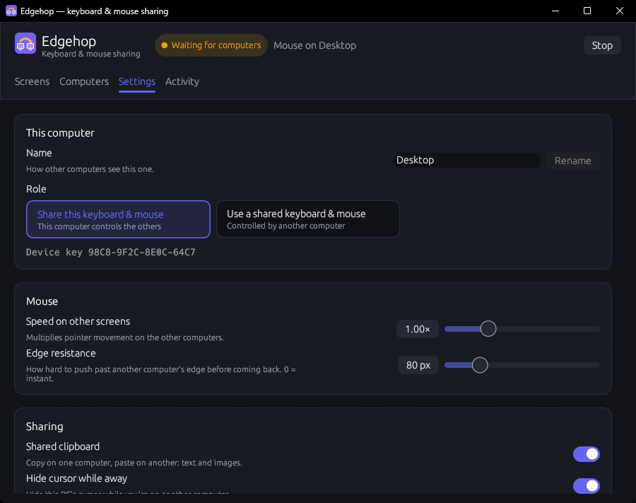

<p align="center">
  
</p>

<h1 align="center">Edgehop</h1>

<p align="center"><b>One keyboard and mouse for every computer on your desk.</b><br>
Push the pointer off the edge of a screen and it hops onto the next computer.</p>

<p align="center">
  
</p>

Edgehop is a software KVM in the spirit of Synergy, Barrier and Input Leap:
one computer (Windows, macOS or Linux) shares its keyboard and mouse with the
others over your local network. There's no separate server to set up: the
computer whose keyboard you're using is the "server".

- **Monitor-level layout**: place each computer against any edge of any monitor,
  like Windows' Display settings. Positions line up across edges, corner to corner.
- **Clipboard sharing**: text, images (snip on one computer, paste on another),
  and *files and folders*: copy on one computer, paste on the other. Big files
  stream over several encrypted connections at once to fill your LAN.
- **Drag files across screens**, in both directions.
- **Encrypted and paired**: Noise protocol (X25519 + ChaCha20-Poly1305). A new
  computer must be approved, and both sides show the same 6-digit code.
- **Finds itself**: clients discover the server on the LAN; no IP typing.
- **Edge resistance**, a hidden cursor while you're away, and on KDE Plasma a
  dimmed screen that stays bright while media plays.
- **Game mode**: the mouse stays put while you play, and on Windows Edgehop's
  mouse hook steps aside entirely so games get untouched input. Turns on by
  itself for fullscreen games; Scroll Lock toggles it.
- **Self-healing**: recovers from hangs, dropped connections and crashes on its own.
- **Share from** Windows, macOS, or Linux (X11, or KDE Plasma on Wayland).
  **Control** Windows, macOS and Linux (X11 *and* Wayland via `uinput`).

<p align="center">
  
</p>

## Download

Grab the latest build from the
**[Releases page](https://github.com/JawshTheDark/edgehop/releases/latest)**.

| Computer | File | Install |
|---|---|---|
| Windows | `Edgehop-Setup-<version>.exe` | Run it. Start menu and desktop icons; starts in the tray when you sign in; uninstall from *Apps & Features* |
| macOS (Apple silicon and Intel) | `Edgehop-<version>-macos-universal.zip` | Move `Edgehop.app` to Applications |
| Ubuntu / Debian | `edgehop_<version>_amd64.deb` (`_arm64` for ARM) | `sudo apt install ./edgehop_*.deb`, then **log out and back in once** |
| Fedora | `edgehop-<version>-1.x86_64.rpm` (`.aarch64` for ARM, e.g. Asahi Linux on a Mac) | `sudo dnf install ./edgehop-*.rpm`, then **log out and back in once** |
| Other Linux | `edgehop-<version>-linux-x86_64.tar.gz` (`-aarch64` for ARM) | Unpack, run `./install.sh`, then log out and back in once |

The builds aren't code-signed yet, so the first launch needs one extra click:
on Windows, SmartScreen's *More info → Run anyway*; on macOS, right-click the
app → *Open* (or *Open Anyway* under Privacy & Security). On macOS, also allow
Edgehop under System Settings → Privacy & Security → **Accessibility**.

The Windows installer needs no admin rights: it installs for you to
`%LOCALAPPDATA%\Programs\Edgehop`, adds Start menu and desktop icons, sets Edgehop
to start in the tray when you sign in (through Task Scheduler), and, if you
leave that option ticked, asks for admin once to allow it through the firewall on
**Private** networks. Running it again updates Edgehop in place. Make sure your Wi-Fi/Ethernet is set to *Private* in
Windows settings. The Linux packages add udev rules so your user can create
virtual input devices and read keyboards and mice (that's why you log out and
in once). For clipboard sharing on Linux, install `wl-clipboard` (Wayland) or
`xclip` (X11); the packages recommend them.

## Build from source

### Windows

Needs Rust (`rustup`) and the Visual Studio C++ Build Tools.

```powershell
cargo build --release
powershell -ExecutionPolicy Bypass -File packaging\windows\build-installer.ps1
```

That makes `dist\Edgehop-Setup-<version>.exe` (it installs Inno Setup with
Chocolatey if needed). `packaging\windows\install.ps1` still installs a build
directly, without an installer.

### Ubuntu

```bash
./packaging/linux/build-deb.sh
```

This installs build tools and Rust if needed, builds a `.deb`, and installs it.

### macOS

```bash
./packaging/macos/build-app.sh
```

This builds `dist/Edgehop.app` (`UNIVERSAL=1` for an Apple silicon + Intel build).

### Making a release

Bump `version` in `Cargo.toml`, add a section to [CHANGELOG.md](CHANGELOG.md),
commit, then push a matching tag:

```bash
git tag v0.2.0 && git push origin v0.2.0
```

GitHub Actions tests and builds every platform and publishes the release with
the changelog section as its notes.

## Using it

1. On the computer with the keyboard and mouse you want to use, open Edgehop.
   Windows starts out sharing; on a Mac or Linux computer, choose **Share this
   keyboard & mouse** under Settings → Role.
2. On the other computer, open Edgehop. It starts as **Use a shared keyboard &
   mouse** and finds the sharing computer by itself.
3. A pairing prompt pops up on the sharing computer. Check that the code matches
   the one on the other computer, then click **Approve**.
4. The new computer shows up to the right of your PC in **Screen layout**. Drag
   it to wherever it physically sits.
5. Move the mouse off that edge. You're now typing on the other computer.

| | |
|---|---|
| Come back | Move the mouse off the opposite edge, or press **Scroll Lock** |
| Game mode | **Scroll Lock** on the sharing computer (F14 on a Mac), the tray menu, or Settings. On Windows it turns on by itself while a fullscreen game (or video) is in front |
| Clipboard | Copy, move to the other screen, paste |
| Mouse too fast/slow on the client | *Mouse speed on other screens* (server) or *Override screen size* (client) |
| Keep running | Close the window → it stays in the tray. Tick *Start Edgehop when I log in*. |
| Updates | Edgehop checks GitHub every few hours and says when there's a new version; **Update now** installs it and restarts (Settings → Updates to switch off or check now) |

**Sharing from a Mac**: allow Edgehop under System Settings → Privacy & Security
→ **Accessibility** (*Device Control and Data Access* on newer macOS; the app
asks), and under **Input Monitoring** if macOS asks for that too. If Edgehop
looks allowed but still can't read the keyboard and mouse (a permission left
over from a copy older than 0.2.1), press **Reset permissions** on the Screens
tab: it clears Edgehop's entries and reopens it so macOS asks again. The same
from Terminal: `tccutil reset Accessibility com.edgehop.app` (and
`ListenEvent`, `PostEvent`). *Command works as Ctrl* (Settings → Keyboard,
on by default) makes Command+C / Command+V copy and paste on Windows and Linux.
Mac keyboards have no Scroll Lock: **F14** brings the mouse home instead.
Trackpad gestures (three-finger swipes, pinches) stay off the Mac while you're
on another computer, so they can't open Mission Control behind your back; they
don't carry across. Files dropped on the Mac land in the Finder window under the
pointer or on the Desktop (macOS asks once whether Edgehop may ask Finder).

**Controlling Linux**: to type your password at the login screen with the
sharing computer's keyboard, switch on Settings → Login screen → *Also work at
the login screen* (or `sudo systemctl enable --now edgehop-login`). If this
computer is set up so Super (Command) works as Ctrl, Edgehop notices from KDE's
or GNOME's keyboard settings (or keyd) and adjusts; if Ctrl+C from the other
computer still doesn't copy, switch on Settings → Keyboard → *Swap Ctrl and Super*.

**Sharing from Linux** works on X11 and on KDE Plasma (Wayland). GNOME on Wayland
doesn't let apps follow the pointer; choose *GNOME on Xorg* at the login screen to
share from there. The package lets the logged-in user read keyboards, mice and
touchpads (`70-edgehop-input.rules`); Edgehop takes them over only while the
mouse is on another computer. From a touchpad, moving, clicking and two-finger
scrolling reach the other computer; tap-to-click doesn't.

Settings live in `%APPDATA%\edgehop\config\config.json` (Windows),
`~/.config/edgehop/config.json` (Linux), or
`~/Library/Application Support/edgehop/config.json` (macOS).

## Troubleshooting

**Debug logging and diagnostics.** In the **Activity** tab, switch on **Debug logging**
(on the server it applies to every connected computer), reproduce the problem,
then click **Save diagnostics**. That writes one file to your Desktop with the
version, settings (keys shortened to fingerprints), monitors, connections and
recent logs from *every* connected computer: attach it to a bug report.
It also holds each computer's **input flight recorder**: the last 2000 raw
input events exactly as the OS reported them, and every switching decision.
That's recorded all the time, so it's there even without debug logging. If the
pointer ever bounces between screens (6 switches in 3 seconds), Edgehop writes
the recorder and the screen layout to the log on its own.
**Include every input event** adds trace-level logging of each key and mouse
push. From a terminal: `edgehop --debug` / `edgehop --trace`, or set
`EDGEHOP_LOG=debug`. Logs live in `%LOCALAPPDATA%\edgehop\cache\edgehop.log`
(Windows) and `~/.cache/edgehop/edgehop.log` (Linux); the previous file is
kept as `edgehop.1.log`.

To measure network transfer speed between two computers:
`edgehop --bench-serve <big file>` on one, `edgehop --bench-fetch <its IP> 1 4 8` on the other.

To check that a computer's clipboard and input work at all, without a server:
`edgehop --self-test` (it briefly moves the pointer). Add `--type` with an empty
text editor in front to also type a sentence, copy it and check the result.
CI runs this on a real Mac for every change (`packaging/macos/smoke-test.sh`);
its screenshots are in each run's *smoke-macos* artifact.


- **Client says "Searching…" forever**: UDP broadcast may be blocked (guest Wi-Fi,
  VPN, or Windows firewall on a *Public* network). Type the server's IP into
  *Address* on the client instead.
- **Linux: "Can't open /dev/uinput"**: log out and in after installing; or run
  `sudo modprobe uinput && sudo setfacl -m u:$USER:rw /dev/uinput` for a quick test.
- **Clipboard on Ubuntu Wayland** needs `wl-clipboard` (installed by the build script).
- **Admin windows on Windows**: if the mouse won't leave while an elevated window
  (Task Manager, an admin terminal) is focused, run Edgehop as administrator.
- Ports: TCP **24800** (connections) and UDP **24801** (discovery).

## Self-healing

edgehop recovers from failures without you having to step in:

| Problem | What edgehop does |
|---|---|
| The computer your mouse is on stops answering | Mouse returns to the server after 3 s; it won't cross into a silent computer until it answers again |
| Connection drops | Both sides reconnect automatically (dead connections are detected within 12 s) |
| Something inside edgehop gets stuck | Input capture passes input straight through after 100 ms (it can never freeze your mouse); a stuck switching state for 5 s restarts edgehop |
| macOS pauses the input tap (it does this to slow apps) | Turned straight back on |
| Windows silently removes the input hooks | Noticed (Windows saw input the hooks didn't) and reinstalled |
| The client's connection loop stalls | Stuck helper processes are killed and it reconnects; if still stuck, edgehop restarts |
| Clipboard tools hang (e.g. on a locked screen) | Given up on after 2 s, off the input path |
| A connection ends with keys or buttons held | They're released |
| A background worker crashes | Logged with its location; the worker keeps running |
| KDE's D-Bus connection drops | Reconnected |
| edgehop crashes or is killed | Cursor is restored, and on Linux the keyboard and mouse are released by the kernel; systemd restarts it (autostart runs it with `Restart=on-failure`) |

You can also restart it from the tray icon (**Restart edgehop**). Everything is
logged to `edgehop.log` (`%LOCALAPPDATA%\edgehop\cache\` on Windows,
`~/.cache/edgehop/` on Linux).

## How it works

```
 Windows (server)                                Ubuntu (client)
 ┌─────────────────────────┐   Noise XX / TCP    ┌──────────────────────────┐
 │ low-level kbd/mouse hook│ ──────────────────▶ │ uinput virtual keyboard  │
 │ edge detection + layout │  key/move/button/   │ + absolute pointer       │
 │ clipboard sync          │  wheel/clipboard    │ clipboard (wl-clipboard) │
 └─────────────────────────┘ ◀── clipboard ───── └──────────────────────────┘
```

Input is captured with low-level hooks on Windows, a Quartz event tap on macOS,
and straight from the kernel's input devices (`/dev/input`) on Linux, which are
grabbed only while the mouse is elsewhere. While a client is active, the
sharing computer parks its own cursor, turns every motion into a delta, and
moves a virtual cursor on the client screen. The client gets absolute coordinates, so the pointer lands
exactly where expected even under Wayland. Keys travel as Linux evdev codes and
are translated to scancodes on Windows and to virtual key codes on macOS.

Run `cargo test` to exercise the switching logic and key maps.
